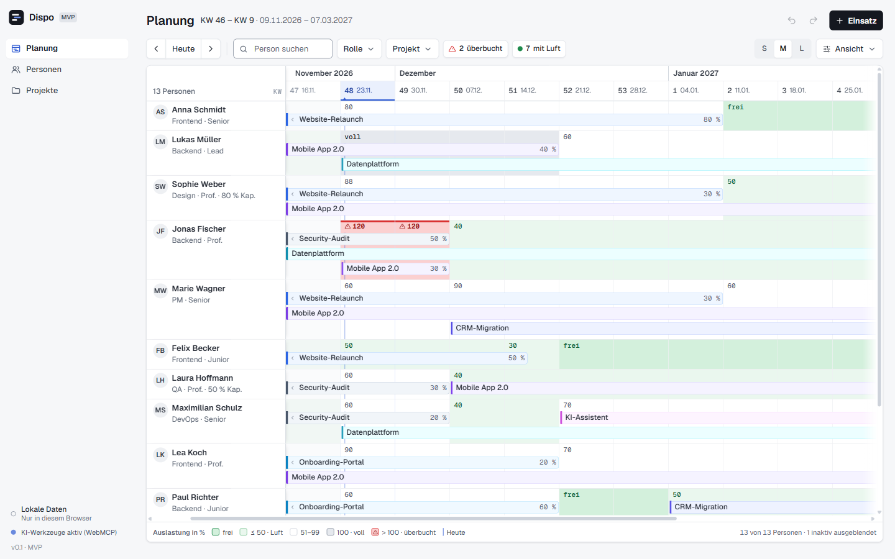

# Dispo – Kapazitätsplanung (MVP)

Dispo ist ein schlankes Planungsboard für Teams, die Personen auf Projekte verteilen. Pro Person und
Kalenderwoche zeigt eine Heatmap die Auslastung relativ zur eigenen Kapazität (Teilzeit eingerechnet),
darüber liegen die Projekteinsätze als Balken. Einsätze werden direkt im Board per Ziehen verschoben,
verlängert oder angelegt; jede Änderung zeigt sofort ihre Folgen (z. B. Überbuchung) und lässt sich
rückgängig machen. Überbuchung wird angezeigt, aber nie verhindert – die planende Person entscheidet.
Die Daten liegen wahlweise nur im Browser oder über eine kleine REST-API in Postgres. Zusätzlich stellt
die App ihre Planungsfunktionen als WebMCP-Werkzeuge für KI-Assistenten im Browser bereit.



## Funktionen

- **Planungsboard:** Wochenraster (Standard: 2 Wochen zurück bis 14 voraus), Auslastungs-Heatmap
  (frei / ≤ 50 % Luft / 51–99 % / 100 % voll / > 100 % überbucht), Projektbalken in Spuren,
  Heute-Linie, Zoom S/M/L, Dichte Komfort/Kompakt, Navigation in 4-Wochen-Schritten.
- **Filter:** Personensuche, Rolle, Projekt (hebt dessen Balken hervor), Schnellfilter
  „überbucht“ und „mit Luft“ mit Zählern, inaktive Personen ein-/ausblenden; `?q=` und `?project=`
  in der URL.
- **Interaktionen:** Balken ziehen (verschieben, auch auf eine andere Person), an den Enden die
  Dauer ändern, auf leerer Fläche ziehen zum Anlegen; Live-Vorschau der Auslastung während des
  Ziehens; Seitenleiste zum Bearbeiten mit Folgen-Vorschau; Tastatur (Pfeile verschieben,
  Umschalt+Pfeile ändern das Ende, Entf löscht); Rückgängig/Wiederholen per Toast, Button und
  Strg+Z / Strg+Umschalt+Z.
- **Personen:** Tabelle mit Kapazität, 8-Wochen-Auslastungsstreifen, „frei ab“, Status; Anlegen,
  Bearbeiten (Live-Warnung, wenn eine Kapazitätsänderung zu Überbuchung führt), Löschen mit
  Rückgängig.
- **Projekte:** Tabelle mit Farbe, Status, Laufzeit, Zeitachse, Personen und FTE der laufenden Woche;
  Anlegen/Bearbeiten (Farbpalette ohne Ampelfarben, Warnung bei Einsätzen außerhalb der Laufzeit),
  Löschen mit Rückgängig.
- **Datenhaltung:** Browser (localStorage, mit Demodaten) oder REST-API (Express + Postgres),
  automatische Auswahl beim Start.
- **WebMCP:** 9 Werkzeuge (Leitfaden mit SOPs für Agenten, lesen, freie Kapazität finden, Einsätze anlegen/ändern/löschen,
  rückgängig) für KI-Assistenten im Browser.

Die vollständige Liste mit Status steht in [docs/COMPLETE_FEATURE_LIST.md](docs/COMPLETE_FEATURE_LIST.md).

## Schnellstart

Voraussetzungen: Node.js ≥ 22, für den Server-Modus zusätzlich Docker.

### Nur im Browser (ohne Server)

```bash
cd client
npm install
npm run dev
```

Die App läuft dann auf <http://localhost:5173>. Ohne erreichbare API arbeitet sie mit lokalen Daten
(localStorage) und legt beim ersten Start Demodaten an (14 Personen, 7 Projekte, 30 Einsätze).

### Mit Server (Postgres)

```bash
# im Wurzelverzeichnis des Repositorys
npm install
npm run db:up        # Postgres 17 in Docker, Port 5433
npm run db:migrate   # Schema anlegen
npm run dev          # API auf http://localhost:3001 (node --watch)

# zweites Terminal
cd client
npm install
npm run dev          # Vite leitet /api an Port 3001 weiter
```

Ist die Datenbank leer, schreibt der Client die Demodaten einmalig über die API. Konfiguration
optional über `.env` (Vorlage [.env.example](.env.example): `DATABASE_URL`, `TEST_DATABASE_URL`,
`PORT`, `CORS_ORIGIN`, `DB_HOST_PORT`). API-Referenz: [docs/api.md](docs/api.md).

### Datenquelle umschalten

`VITE_DATA_SOURCE` (z. B. in `client/.env.local` oder als Umgebungsvariable beim Start von Vite):

| Wert | Verhalten |
|---|---|
| `auto` (Standard) | prüft `GET /api/health` (1,5 s); antwortet die API, wird sie genutzt, sonst lokale Daten |
| `api` | immer die REST-API; ist sie nicht erreichbar, zeigt die App einen Fehler mit „Erneut versuchen“ |
| `local` | immer localStorage, ohne Server |

Die aktive Quelle steht unten in der Seitenleiste („Lokale Daten“ bzw. „Server“).

## Tests

| Was | Befehl | Hinweise |
|---|---|---|
| Client: Unit- und Komponententests | `cd client && npx vitest run` | Vitest + Testing Library (jsdom); `npm test` startet den Watch-Modus |
| Client: Typen, Lint, Build | `npm run typecheck`, `npm run lint`, `npm run build` | in `client/` |
| API-Tests | `npm test` | im Wurzelverzeichnis; braucht Postgres (`npm run db:up`), nutzt die Datenbank `dispo_test` |
| API-Lint | `npm run lint` | im Wurzelverzeichnis |
| E2E-Smoke-Tests | `cd client && npm run test:e2e` | Playwright/Chromium, startet Vite mit `VITE_DATA_SOURCE=local`; einmalig `npx playwright install chromium` |
| E2E gegen die API | `E2E_DATA_SOURCE=api npm run test:e2e` | startet zusätzlich den Server; Postgres muss laufen |

## WebMCP (KI-Werkzeuge)

Bietet der Browser WebMCP an (`document.modelContext`), registriert die App 8 Planungswerkzeuge;
die Seitenleiste zeigt dann „KI-Werkzeuge aktiv (WebMCP)“. Änderungen durch einen Assistenten laufen
über dieselbe Validierung und Undo-Historie wie die Oberfläche und erscheinen als Toast mit
„Rückgängig“. Werkzeuge, Ausprobieren und Sicherheit: [docs/webmcp.md](docs/webmcp.md).

## Projektstruktur

```
client/                  React 18 + TypeScript + Chakra UI 2 (Vite)
  src/domain/            reine Logik: Datum/ISO-Wochen, Auslastung, Validierung,
                         planningActions (einziger Schreibpfad, Undo/Redo), Projektfarben
  src/data/              Repository-Interface, LocalRepository, HttpRepository,
                         Datenquellen-Auswahl, Demodaten
  src/state/             PlanningProvider (Daten + Aktionen als React-Kontext)
  src/features/board/    Planungsboard, Layout-Geometrie, Drag & Drop, Drawer, Toasts
  src/features/people/   Personen-Seite
  src/features/projects/ Projekte-Seite
  src/features/webmcp/   WebMCP-Adapter, Werkzeuge, Bridge, Statuszeile
  src/components/layout/ Shell und Seitenleiste
  tests/                 Playwright-E2E-Smoke-Tests
server/                  Express 4 + pg: REST-API, Validierung, Migrationen, Tests (node:test)
db/init/                 legt beim ersten Container-Start die Testdatenbank an
docs/                    API, WebMCP, Feature-Liste, Screenshot; archive/ = alte Planungsunterlagen
```

## Bekannte Einschränkungen

- Keine Anmeldung, keine Rechte, kein Mehrbenutzerbetrieb: gleichzeitige Änderungen werden nicht
  erkannt („last write wins“), andere Clients sehen Änderungen erst nach dem Neuladen.
- Keine Abwesenheiten (Urlaub, Krankheit), keine Skills und keine Projektbedarfe/Anforderungen.
- Keine Zeilenvirtualisierung: ab etwa 100 Personen wird das Board träge.
- Kein automatisches Scrollen am Rand, während ein Balken gezogen wird.
- Touch: Verschieben und Dauer ändern funktionieren, Anlegen per Ziehen auf leerer Fläche ist
  eingeschränkt (dafür „+ Einsatz“ verwenden).
- WebMCP ist nur mit einem Test-Stub geprüft; die native Implementierung in Chrome und die Anbindung
  von Claude über das MCP-B-Relay sind ungetestet.
- Das Client-Bundle ist ein einzelner Chunk > 500 kB (kein Code-Splitting).

## Lizenz

Siehe [LICENSE](LICENSE).
